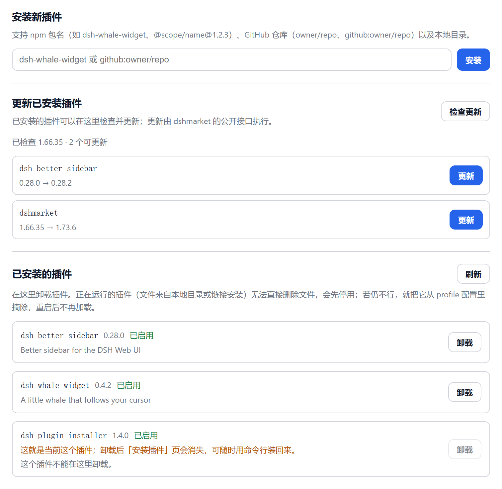
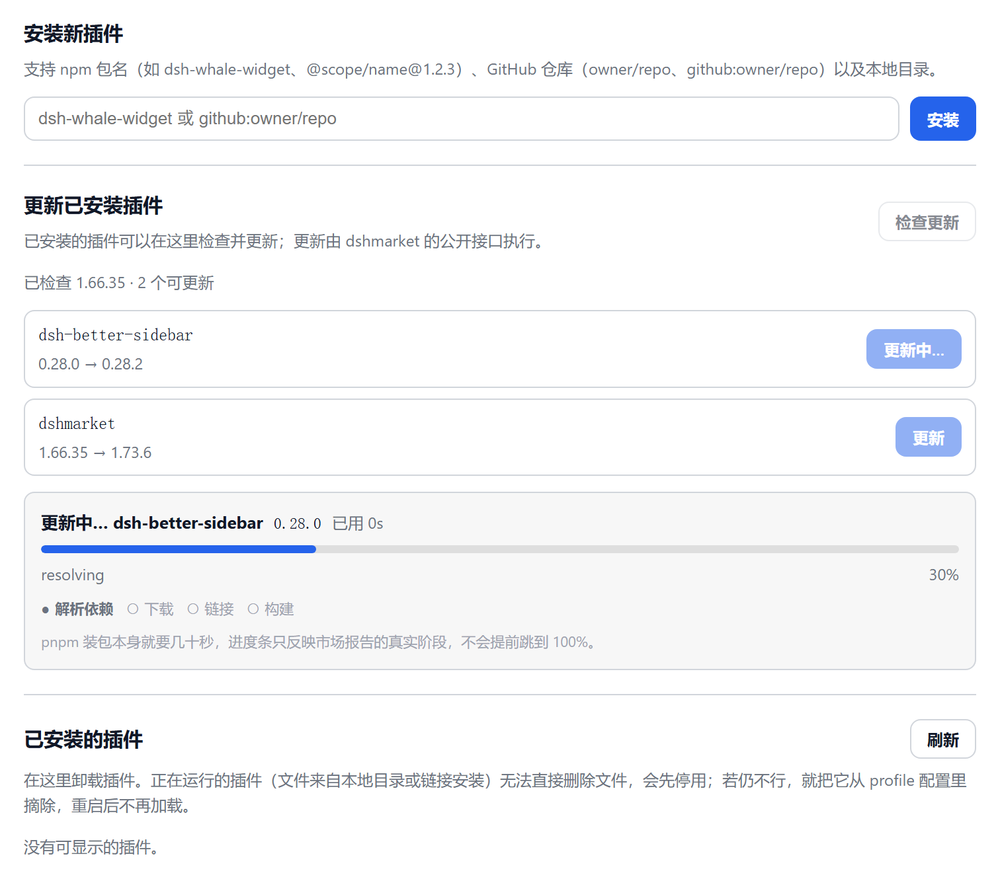
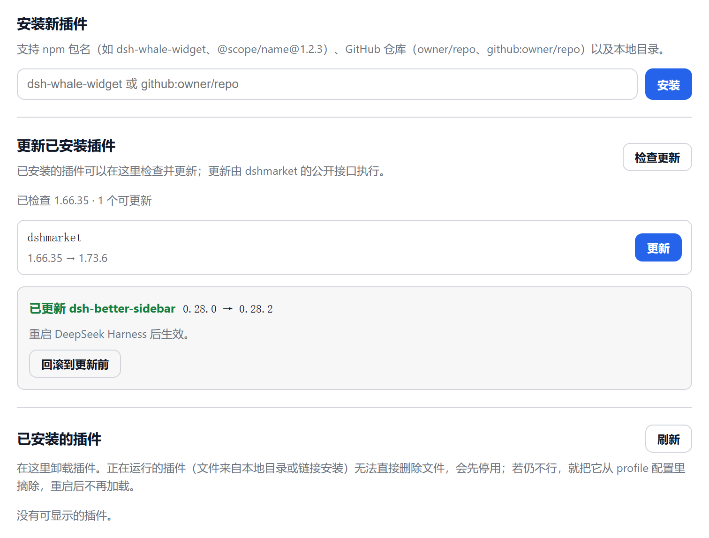
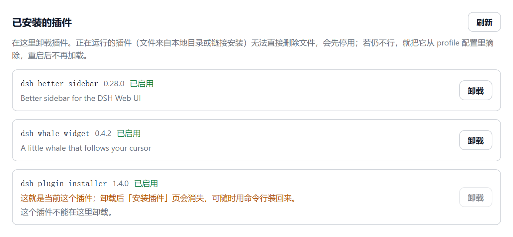
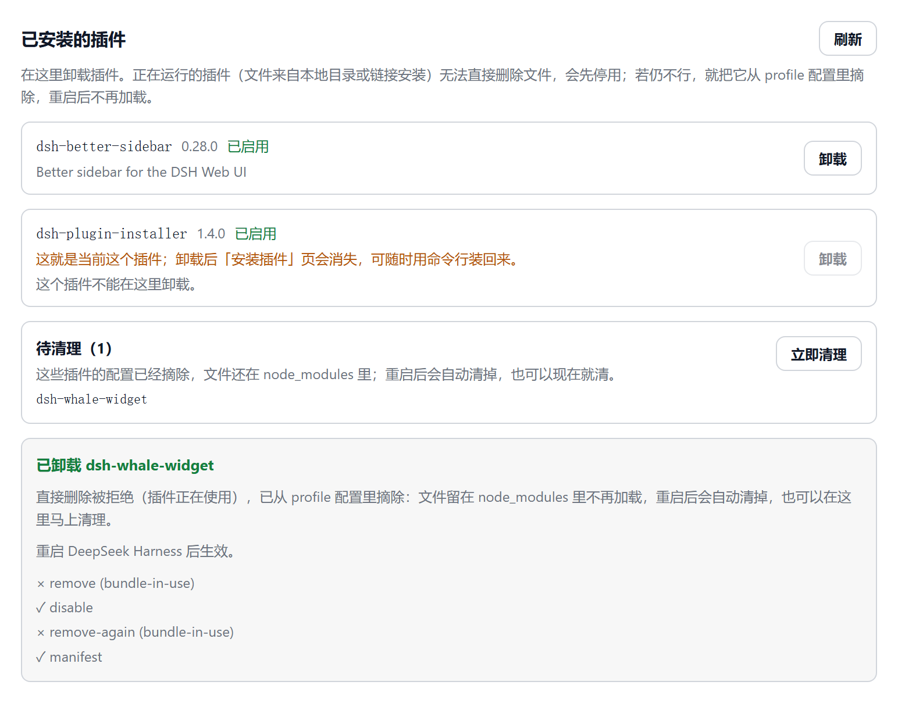
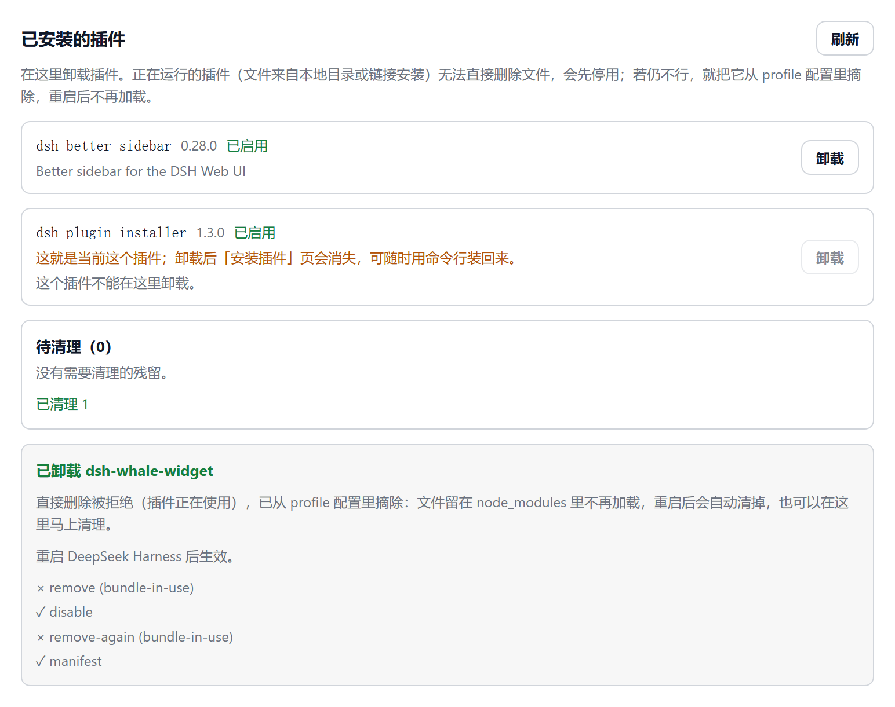

# dsh-plugin-installer

[](LICENSE)
[](https://github.com/DogEgg-alR/dsh-plugin-installer)

在 DeepSeek Harness 客户端界面里**直接安装和更新插件**的插件。

官方桌面端有个绕不开的限制：profile 由 app 独占，应用运行时 `dsh plugin --profile desktop add …`
这条命令改不动它（pnpm 锁 + 加载器配置都在进程手里）。于是 GUI 里唯一能装插件的入口就是
官方插件页那一个——而它只负责「已安装」和官方来源。

这个插件把安装和更新搬进界面：

- **安装**：输入包名 / GitHub 仓库 / 本地目录 → 走 profile 自己的 `pluginManager` 服务安装，
  和官方插件页同一个实现，所以应用运行中也能装，不会撞锁。
- **更新**：一次列出所有已装插件的版本对比，逐行更新，带进度、失败原因和「回滚到更新前」。
  更新算法不重写——直接调 dshmarket 的公开更新接口 `dsh-market/update-api/v1`。



## 安装

```sh
# 方式一：普通 profile（dsh web / CLI）
dsh plugin --profile web add github:DogEgg-alR/dsh-plugin-installer

# 方式二：手动写进 profile
cd ~/.dsh/profiles/web
pnpm add github:DogEgg-alR/dsh-plugin-installer
```

方式二还需要在 `package.json` 的 `dsh.profile.bundles` 里追加 `"dsh-plugin-installer"`
（或在 profile 的 `cordis.patch.yml` 里插入挂载行），两种方式不要同时用。

**官方桌面端（DeepSeek Harness.exe）**：应用运行时 CLI 改不动 desktop profile，有两条路——

1. 让 DSH 自己装（见下一节），或
2. 完全退出应用 → 在外部终端执行上面方式一、把 `web` 换成 `desktop` → 重新打开。

装上后**重启一次**（新增的 bundle 只在启动时读加载器配置），然后在
设置 → 插件 里会多出一个 **「安装与更新」** 标签页。之后装别的插件就不用再重启了。

## 让 DeepSeek Harness 帮我装

把下面这段直接粘给 DSH 的对话窗口：

```text
帮我装插件 github:DogEgg-alR/dsh-plugin-installer 。
用 plugin_manager 工具的 install_bundle，target 填绝对路径或 spec；
装完把 application 字段告诉我，如果是 restart-required 就提醒我重启客户端。
不要自己改 profile 的 package.json，也不要手跑 pnpm。
```

装完之后，以后所有插件都能在 设置 → 插件 → 安装与更新 里点出来。

## 使用

### 安装

输入任意 pnpm 认的 spec：

| 写法 | 例子 |
| --- | --- |
| npm 包名 | `dsh-whale-widget` |
| 指定版本 | `dsh-better-sidebar@0.28.2` |
| GitHub 仓库 | `github:DogEgg-alR/dsh-plugin-installer`、`owner/repo` |
| 本地目录 | `C:\Users\me\dsh-plugins\my-plugin` |

点「安装」开始，装完会告诉你结果是「已生效」还是「重启后生效」。
失败时给出可操作的原因（已安装 / 不是插件包 / 依赖歧义已回滚 / 版本不兼容 / pnpm 输出）。

### 更新

点「检查更新」→ 看到每行的 `当前版本 → 最新版本` → 点某一行的「更新」。



进度条跟着市场报告的 `phase / percent / downloaded / detail` 走：

- 有 `percent` 时是确定进度条（宽度 320ms 过渡），右侧是百分比；
- 还没报总数时是一条滑动的条，不会假装知道百分比；
- 下面四个阶段 `解析依赖 → 下载 → 链接 → 构建` 来自 pnpm 的 `pnpm:stage` 事件，
  当前阶段加粗、已完成的打勾——长时间停在「下载」时能看出是卡在哪一步，而不是一个空转的圈；
- 头部有 `已用 Ns` 走秒，卡片底部有一句说明：**进度条不会自己跳到 100%**。

轮询是 400ms（启动更新后立刻读一次），所以显示最多比真实状态慢不到半秒。真正的耗时在
pnpm 上：它要在整个 profile 里重新解析并落盘，几十秒是常态，这个插件不会、也不该缩短它——
只是把它变成看得见的过程。结束后：



- 成功：显示新版本，提示重启，并把这一行从可更新列表里移除；
- 失败：显示稳定失败码的中文解释（版本回退被拒、版本没变、有 agent 在跑、操作忙、超时…）；
- 只要市场给了恢复点，就出现「回滚到更新前」；
- `RELEASE_TOO_FRESH` / `VERSION_UNCHANGED` 两种情况额外给一个「强制更新」。

更新区需要装 [dshmarket](https://github.com/dsh-market/dsh-market)。没装时这一块只显示一句
提示，不会假装能更新，也不影响上面的安装功能。

### 卸载

列表里每一行都能「卸载」（两步确认），不用去命令行。麻烦的是最后一类情况：

> 这个插件正在使用中，桌面端不允许现在移除 / the plugin is in use, and the desktop app
> will not remove it right now (`bundle-in-use`)

这条限制来自 `pluginManager.removeBundle()`：它会先让 HMR 把该组合包的条目卸载掉，
卸不掉就直接拒绝，因为**不能把文件从正在运行的代码下面抽走**。本地目录 / 链接安装的插件
几乎必然命中它——代码就在你眼前跑着。

所以这里分三步走，能走通哪一步结果里就写哪一步：

1. 直接移除；
2. 被拒（`bundle-in-use` / `stop-profile`）→ 先停用这个组合包，再移除；
3. 还被拒 → 只把它从 profile 配置里摘掉：`dependencies` 与 `dsh.profile.bundles`
   各删一条，重启后不再组合。文件留在 `node_modules` 里不再加载，下次安装会被覆盖/清掉。

第 3 步不需要 pnpm，也不会碰正在运行的进程，随时安全。界面上会明确告诉你走的是哪一步
（「已先停用再删除」还是「已从 profile 配置里摘除」），以及是不是要重启才彻底消失。



走第 3 步时插件会被记进「待清理」队列（`<profile>/.dsh-plugin-installer/pending-cleanup.json`）：



- 下次宿主启动约 10 秒后自动扫一遍队列，把 `node_modules` 里的残留删掉——此时进程里已经没有
  那份代码，删文件是安全的；
- 不想等重启也可以点「立即清理」，`POST /dsh-plugin-installer/api/cleanup` 立刻执行同一套清理；
- 清理前会再确认一次这个包**没有**重新出现在 profile 配置里：你要是刚把它装回来，它就自动出队、
  不会被动到；删失败的条目留在队列里并累加 `attempts`，下次启动再试。



## 工作原理

- **安装**：客户端半调宿主半的 HTTP 桥（`POST /dsh-plugin-installer/api/install`），
  宿主半调 `ctx.get('pluginManager').installBundle(spec, { requestId })`。
  pnpm 要跑几十秒，所以 POST 立刻回 `202 { jobId }`，客户端轮询
  `GET /dsh-plugin-installer/api/job?id=` 取结果——避免长连接被代理或应用层掐断。
- **更新**：客户端半先 `GET /dsh-market/api/v1/capabilities` 做特性探测，
  `features.update === true` 才启用任何变更按钮（市场 v1 契约要求），
  然后 `POST /updates` → 轮询 `GET /operations?operationId=` → 必要时 `POST /rollback`。
- **为什么不用 CLI**：桌面端 profile 归 app 所有，`dsh plugin` 在应用运行时会等文件锁。
  进程内的 `pluginManager` 才是官方插件页用的那条路。
- **卸载**：`POST /dsh-plugin-installer/api/remove` + 同一条 job 轮询。宿主半按
  「直接移除 → 停用后再移除 → 从 profile 配置摘除」逐级降级（见上文「卸载」），
  每一步的结果都回给界面，所以按钮不会卡在一句你无法处理的话上。
- **清理残留**：摘除后的包名写进 `<profile>/.dsh-plugin-installer/pending-cleanup.json`；
  宿主启动 10 秒后（`ctx.effect` 管着定时器，插件卸载时一起清掉）扫一遍队列，
  `GET/POST /dsh-plugin-installer/api/cleanup` 让界面能看队列、也能立刻触发同一套清理。
  删除前会读一遍 profile 配置，确认该包没被重新声明——避免把刚装回来的插件删掉。
- **为什么不自己实现更新**：版本校验、release-age 策略、恢复点与回滚都在市场里；
  重写一遍只会和它打架，所以这里只做转发和展示。

## 兼容性

- DeepSeek Harness 桌面端 / `dsh web`，profile 名任意
- 更新功能需要 dshmarket 1.66+（`update-api/v1`，beta）
- 客户端半只依赖 `react`（由加载器注入），无其它前端依赖

## 目录结构

```text
dsh-plugin-installer/
├─ lib/index.js        # 宿主半：安装桥（webServer 路由 + pluginManager）
├─ client.js           # 客户端半：plugins.tab 里的「安装与更新」
├─ cordis.patch.yml    # bundle patch：把插件挂进 profile
├─ package.json        # dsh.bundle.patch + dsh.client
└─ assets/             # README 截图
```

## License

MIT
